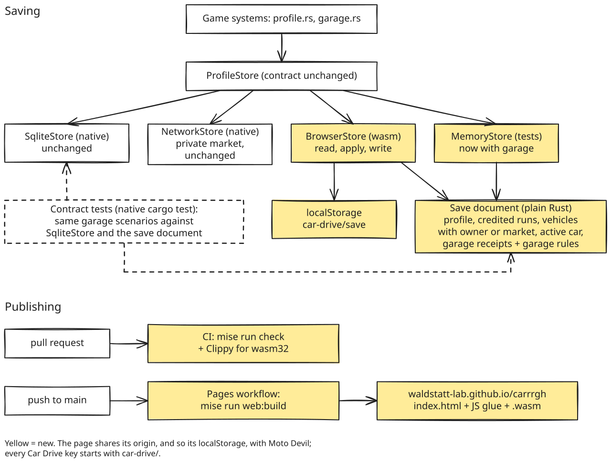

# Problem

Car Drive only runs as a native program. To try it, a friend needs Rust, the
pinned toolchain, Clang and on NixOS a `nix-shell`, and has to build the game
first. Nobody can just follow a link and drive. Its sibling
[Moto Devil](https://github.com/waldstatt-lab/moto-devil) already does exactly that: it
is published as a browser game on GitHub Pages.

A browser build without a save would lose most of what makes Car Drive more than
a single run: the coin balance, the ten vehicles bought and tuned in the garage,
and the marketplace where a sold car can be bought back. Today all of this lives
in `profiles.sqlite3` through `SqliteStore`, which is not compiled for `wasm32`.
[ADR 0007](../../architecture/decisions/0007-persist-profiles-behind-a-store-interface.md)
already says that a browser build needs another `ProfileStore`. The
garage and market rules (prices, buyback, transaction receipts, starter car once)
are written as SQL transactions in `storage/sqlite/garage.rs`, so no other
backend can reuse them as they are.

The repository also has no CI. Whether `main` builds and its tests pass is known
only to whoever last ran `mise run check`. A second target, the browser, is easy
to forget locally.

**Status: implemented.** The store is recorded in
[ADR 0011](../../architecture/decisions/0011-keep-the-browser-save-as-one-document-in-local-storage.md),
and the [architecture](../../architecture/README.md#browser-build-and-publishing)
describes the build. Two details differ from the shaping below. With a save, the
game opens the garage first, as it does natively; G or "Drive / Start" begins the
drive. The document keeps only the latest 256 garage receipts and credited runs,
which is enough to guard the retry of the operation in flight. The repository
is public; choosing "GitHub Actions" as the Pages source is still a manual step.

# Solution

**Car Drive is also built as a static web page and published to GitHub Pages on
every push to `main`. In the browser, a new `ProfileStore` keeps the whole save
(player, coins, garage, local marketplace) as one versioned JSON document in
`localStorage`. Pull requests are checked by CI.** It is the same game in the
browser: same road, traffic, vehicles, garage and keys. Native play, the SQLite
save and the private network market stay as they are.

The approach follows Moto Devil's
[browser game pitch](https://github.com/waldstatt-lab/moto-devil/blob/main/docs/pitches/browser-game/pitch--browser-game.md)
and its ADR 0010 wherever the two games are alike: page, build tasks, CI and
Pages. Car Drive differs in what it saves. It has transactions instead of two
texts, so the store is shaped differently.

## Playing in the browser

Source: [pitch--browser-game.breadboard.excalidraw](pitch--browser-game.breadboard.excalidraw).

- **Arriving.** The link opens a plain page with the playing field in the
  native window's 6:5 shape (960 × 800). It grows with the browser window and
  sits centred on a dark background. Until the game is ready it shows
  "Loading …".
- **Focus.** A click on the field gives it the keyboard. Arrow keys, Space, Tab
  and Backspace then steer, boost, switch garage tabs and restart instead of
  scrolling or leaving the page.
- **No WebGL2.** A browser without WebGL2 gets a short hint instead of an empty
  field.
- **Then the known flow.** Without a save, "NEW PLAYER" asks for a name. With a
  save, the player drives straight away. At the end of the road the coins are
  credited, R drives again and G opens the garage. The garage has the same tabs
  as natively: my vehicles (select, tune, sell now), showroom and marketplace.
- **The marketplace is this browser's own.** It works like native offline play:
  selling pays immediately, and the sold car becomes a listing in the same save
  that can be bought back later. There is no shared online market in the
  browser.
- **Esc outside the garage** quits the native game. In the browser this would
  freeze the field, so there Esc does nothing outside the garage. To stop
  playing, you close the tab. Esc still closes the garage.
- **Reopening the tab** later finds the same player, coins, vehicles, tuning and
  listings.

## Saving in the browser

Source: [pitch--browser-game.storage.excalidraw](pitch--browser-game.storage.excalidraw).

- **The contract stays.** `profile.rs` and `garage.rs` keep talking to
  `ProfileStore` only: load, create, credit, garage request. No game system
  learns about the browser.
- **A save document** is new. It is plain Rust data: the profile and its coins,
  the run IDs already credited, every vehicle with its owner (the player or the
  market), the active vehicle, whether the starter car was granted, and the
  garage transaction receipts. Garage operations are functions on this
  document. They give the same answers as the SQLite transaction: the same
  catalogue-version check, prices from `vehicles.rs`, the starter Corsa once, no
  selling the last or active car, exact retries returning the snapshot, a reused
  transaction ID with other arguments rejected, and 20 listings per page. A
  rejected operation leaves the document unchanged.
- **The document has its own version**, with its own format marker and
  version 1, separate from the SQLite schema numbers. It is checked as carefully
  as the SQLite file is on load. Names are parsed again, balances stay within
  limits, every vehicle passes `validate`, and the active vehicle must be owned.
- **`BrowserStore`** (wasm only) keeps the document under the `localStorage`
  key `car-drive/save`. Each operation reads the item, applies the change to
  the document and writes the item back in one `setItem`, before its future
  completes. `localStorage` is synchronous, so the future is already finished
  when it is returned, as with `MemoryStore` today. The store holds no browser
  handles between calls, so it satisfies `Send + Sync`, and `IoTaskPool` and
  `BoxedFuture` keep working unchanged.
- **`MemoryStore`** (tests only) keeps the same document in memory. It gains a
  garage this way, so garage and plugin tests can run headless without SQLite.
- **Contract tests** run the same garage scenarios as the SQLite tests against
  the document. Examples: a sale pays once, a rejection changes nothing, a
  transaction ID cannot be reused, the starter car is granted once, and a
  listing can be bought back. This catches drift between the two copies of the
  rules in a normal native `cargo test`.
- **Which store is used** is decided by `main.rs` per target: SQLite or the
  network market natively, `BrowserStore` in the browser. `market.rs` (TCP,
  threads, command line) and `SqliteStore` are compiled natively only.
- This adds a second, lasting backend with its own rule implementation. It gets
  a new ADR that amends ADR 0007, and the architecture documentation describes
  it.

## Building for the web

- The same crate is also built for `wasm32-unknown-unknown`. There is no second
  crate and no copy of `main.rs`. Browser-only parts (canvas, store, Esc) sit
  behind the target.
- WebGL2 renders the procedural 2D shapes. Bevy's built-in font is compiled in,
  and the game has no asset files. So the page loads only `index.html`, the
  JavaScript glue and the `.wasm`, and it works under the `/carrrgh/` subpath of
  Pages.
- The tools and tasks are Moto Devil's. The `wasm32` target, `wasm-bindgen` CLI,
  `wasm-opt` and `miniserve` are pinned in `.mise/config.toml`. A size-optimised
  `web` profile builds the page, and the mise tasks `web:build` (writes
  `dist/web`) and `web:serve` (local trial) are new. A small hand-written
  `web/index.html` lives in the repo.

## CI and publishing

- **CI** runs on every pull request with two jobs side by side. The native job
  runs `mise run check` (format, Clippy, build, tests). The web job runs Clippy
  for `wasm32`. The tests are headless and need no GPU.
- **Pages** runs on every push to `main` and on demand. It builds the web
  version, uploads it as the Pages artefact and publishes it. Only one
  publication runs at a time; a newer one replaces a running one.
- **Once, by hand:** make the repository public, and select "GitHub Actions" as
  the Pages source in the repository settings. The page will be at
  `https://waldstatt-lab.github.io/carrrgh/`.
- `CONTRIBUTING.md` and the architecture documentation then describe CI, the web
  build and publishing. The sentence "There are no CI workflows yet" goes.

## How we judge the experiment

- Open the link, create a player with an umlaut in the name, drive, earn coins,
  buy a car, tune it and sell the old one. Close the tab and reopen it: the
  player, balance, garage and the listing are still there, and the sold car can
  be bought back.
- Two reloads give different traffic. Random seeds really come from the
  browser.
- The game runs smoothly in current desktop Firefox and Chrome and feels like
  native.
- Native play is unchanged. An existing `profiles.sqlite3` loads, and the
  private market still works over its SSH tunnel.
- A pull request shows the CI result, and a push to `main` updates the page.

# Security

- **The save in `localStorage` is untrusted input**, like the SQLite file.
  Its size is checked before parsing. It is decoded defensively and validated
  completely, as described above. An unusable document is moved aside to
  `car-drive/save.broken` and never used.
- **Shared origin.** All project pages of the `waldstatt-lab` account share the origin
  `https://waldstatt-lab.github.io`, and with it `localStorage`. Moto Devil
  already lives there. Other pages of the account can read and change Car
  Drive's save, for example to raise the coins. This is accepted. ADR 0007
  already treats the local save as editable, the browser market is local to
  that save, and no coins from the browser ever reach the private network
  market. The `car-drive/` prefix avoids accidental collisions with
  `moto-devil/`.
- **No data leaves the device.** The browser build contains no network store,
  makes no network calls and loads no foreign scripts, fonts or analytics.
  Everything comes from the same origin.
- **Making the repository public** publishes its whole history. Before
  switching, check the history for anything private: market credential files,
  tokens, local data directories, `profiles.sqlite3` files. The private market
  protocol becomes readable; it still binds to loopback only and stays behind
  SSH, as ADR 0009 requires.
- **Workflows with narrow rights.** The default is read access to contents
  only. Only the publish job gets `pages: write` and `id-token: write`. CI runs
  on `pull_request`, not `pull_request_target`, so foreign code gets no rights.
  Publishing happens only from `main`. There are no secrets. Only official
  `actions/*` and a few common actions (mise, Rust cache) are used, pinned to a
  commit.

# Rabbit Holes

- **The garage rules exist twice**: as SQL and as document functions. The
  contract tests keep them together. SQLite is not rewritten to load and store a
  document, and no abstraction over "tables" is built that would serve both.
  Shared pure pieces (prices, `configure`, validation) already live in
  `vehicles.rs` and stay there.
- **Browser handles are not `Send`.** `web_sys::Storage` must not be kept in
  the store or held across an `.await`. Fetch it for each operation, finish the
  work synchronously and return a ready future. No `wasm-bindgen-futures`, no
  `spawn_local`, no change to the `ProfileStore` signature.
- **Randomness in the browser.** `getrandom` 0.3 and 0.4 are both in the lock
  file, and `fastrand` seeds the traffic, run IDs and vehicle IDs. On
  `wasm32-unknown-unknown` each needs its browser backend (`wasm_js` for
  `getrandom`, and `js` for `fastrand` if that is still needed). Otherwise the
  build fails or every visit gets the same seed, and vehicle IDs could repeat.
  Turn on only what is needed for `wasm32`, and check with the "two reloads"
  test.
- **Exit and closing the tab.** Natively, `profile.rs` waits on `AppExit` for
  outstanding credits. A closed tab sends no `AppExit`. With synchronous writes
  nothing is outstanding once a credit has been issued. A drive in progress is
  lost when the tab closes, like a crash natively. No `beforeunload` handler.
- **Two tabs.** Each operation reads the document fresh before changing it, so
  one tab sees the other's purchases on its next action. Writes that land at
  almost the same moment are resolved by the last one winning. No Web Locks,
  no `storage` events.
- **Missing, full or newer save.** If `localStorage` is blocked (private mode,
  disabled site data) or full, the store reports `Unavailable`, and the
  existing "coins not saved" message shows. There is no fallback store. A
  document from a newer version can appear when an old cached page meets a
  newer one in another tab. It is refused and not overwritten (`NewerSchema`).
- **`wasm-bindgen` version.** The CLI must match `wasm-bindgen` 0.2.130 in
  `Cargo.lock` exactly. It is pinned through mise. No Trunk, no `wasm-pack`, no
  bundler.
- **Page size.** The `web` profile optimises for size (LTO, `wasm-opt`). That is
  enough. No splitting and no further trimming of Bevy features. "Loading …"
  covers the wait.
- **Keyboard in the browser.** Bevy suppresses the browser's default actions on
  the field, which is wanted so that arrows, Space and Tab stay in the game.
  Browser shortcuts such as F5 then do nothing while the field has focus. This
  is accepted. Check name entry with umlauts and dead keys on German and Swiss
  layouts. No IME and no on-screen keyboard.
- **Background tab.** The browser pauses hidden tabs. When the player returns,
  the fixed step must not catch up seconds of driving into a truck. Bevy's cap on
  time per frame should be enough. A separate pause mode is added only if
  testing shows it is not.
- **CI environment.** `.cargo/config.toml` links with Clang and LLD on Linux.
  Bevy needs ALSA, udev, Wayland and xkbcommon headers, and bundled SQLite
  compiles C. The runner installs exactly that, and a Rust cache shortens runs.
  No operating-system matrix.

# No-Gos

- No shared online marketplace in the browser, and no network store,
  WebSocket proxy, server, accounts or sync between devices or between native and
  browser.
- No import or export of a native `profiles.sqlite3` in the browser, and no
  export of the browser save.
- No IndexedDB, no SQLite compiled to wasm, no Bevy `SettingsPlugin`.
- No change to the SQLite schema, the catalogue, prices or the private market's
  protocol.
- No touch or phone controls. Play is in a desktop browser with keyboard, and a
  gamepad only if the browser reports one anyway.
- No WebGPU build, no multithreaded build, no service worker or offline mode.
- No custom domain and no preview pages per pull request.
- No landing page, no fullscreen button, and no page design beyond the field,
  "Loading …" and the WebGL2 hint.
- No native release builds or downloads from CI.
- No tuning or gameplay changes for the browser.
